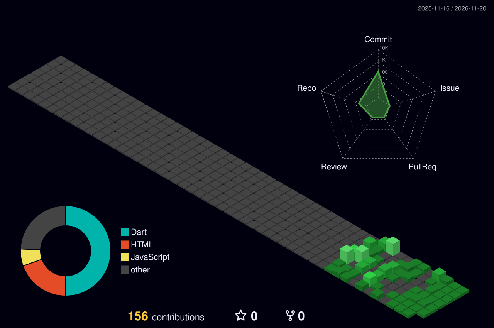

<strong>saya adalah generasi yang lahir saat kenologi sudah ada semuanya. Saya adalah generasi yang mengalami accumulated complexity gap. Saya juga memiliki Tacit knowledge yang terbatas, ya soalnya saya tumbuh dewasa pas semuanya udah ada</strong>

My dream:
Saya ingin indonesia punya OS dan CPU sendiri. Jika tiongkok cenderung menguasai pasar regional-nya, maka indoensia sebaiknya menarget pasar global saja. singkatnya, teknologi indonesia bisa join tongkrongan global, sedangkan tiongkok terjebak di negaranya sendiri.
MENURUT KEYAKINAN SAYA, indonesia bisa mulai dengan:
1. mengambil ISA risc v dan membuat konfigurasi tambahan yang disesuaikan untuk indonesia.
2. hasil custom risc v itu bisa dijadikan IP sendiri.
3. lalu cetak, entah ke TSMC atau samsung foundry atau lainya yang mendukung
4. lalu untuk OS, bisa custom linux, dan difokuskan untuk arsitektur x86 dan risc-v-like
5. OS linux custom itu bisa dibuat dengan pure rust agar aman memory
6. dikembangkan juga komponen-komponen pendukungnya atauu dependensinya baik untuk hardware dan software (pada bagian ini saya masih belum kepikiran seperti apa dependensinya, pengetahuan saya lebih banyak di ISA risc v dan linux saja)
7. semua dikembangkan satu arah dan menghindari fragmentasi. disini indonesia bisa pakai kekuatan regulasi dan kemampuan lobbying.

Kumpuulkan semua ahli, produsen herdware dan software dalam negara dan bangun kesepakantan bersama.
ini bisa kalau semua mau bersama-sama.
Skeptis? iya, tapi saya juga skeptis kalau tidak bisa diwujudkan.

warga terlalu sibuk dengan politik, hal-hal mistis, simbolisasi dan feodalisme. mungkin karena mereka belum kenyang. untuk urusan perut, itu saya kembalikan ke negara, saya ingin menjadi bagian dari STEM (sains, teknologi, engineering, dan metermatika) negara. Bagian mana? bagian perancangan perangkat lunak sistem operasi dan penyesuaiannya dengan set arsitektur chip, terutama yang custom negara tadi.

Note: catatan my dream ini saya ketik sendiri secara manual dengan keyboard. saya harap pembaca mengerti perasaan saya terhadap pengembangan teknologi indonesia.
